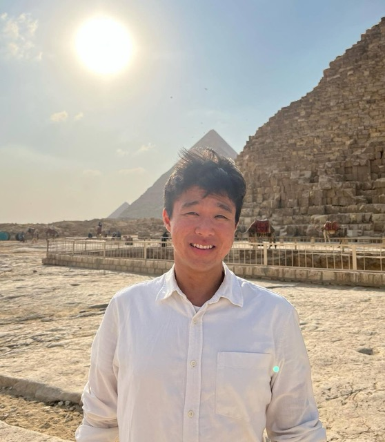

My name is Jason (Jaemyoung) Lee (Korean: 이재명). I was born and mostly raised in South Korea, apart from five years spent in Southern California as a child. It was during those years that I fell in love with astrophysics and decided to become an astrophysicist.

In third grade, I made a pop-up book about Venus for a class project. Although my mother had to make most of the book itself—I am far from a crafty person—the project drew me into astronomy and astrophysics.

My initial interests were in planetary science. During the final years of my undergraduate studies at Korea University and the University of Toronto, I became involved in cosmology research, which led me to my current path.

{: .align-center width="420" }

## Academic path

### Korea University

I double-majored in Physics and English, with a focus on literature, and played in a close-knit orchestra. As an intern in Professor Eunil Won's laboratory, I learned to code and became familiar with software commonly used in cosmology.

### University of Toronto

As a study-abroad student, I became involved in full-scale cosmology research. With Professor J. Richard Bond, Pavel Motloch, Alex van Engelen, and George Stein, I studied the non-Gaussianity of the cosmic infrared background and its gravitational lensing. The project continued into my graduate years and taught me an immense amount about research.

### University of Pennsylvania

At Penn, I transitioned to Type Ia supernova cosmology with my Ph.D. advisor, Professor Masao Sako. I investigated wavelength-dependent atmospheric effects in SN Ia cosmology and helped show that these effects can be used to measure supernova redshifts. I also worked with Professor Ravi Sheth on model-independent BAO scales.

Outside research, I enjoy traveling and playing classical music on the piano and violin.
