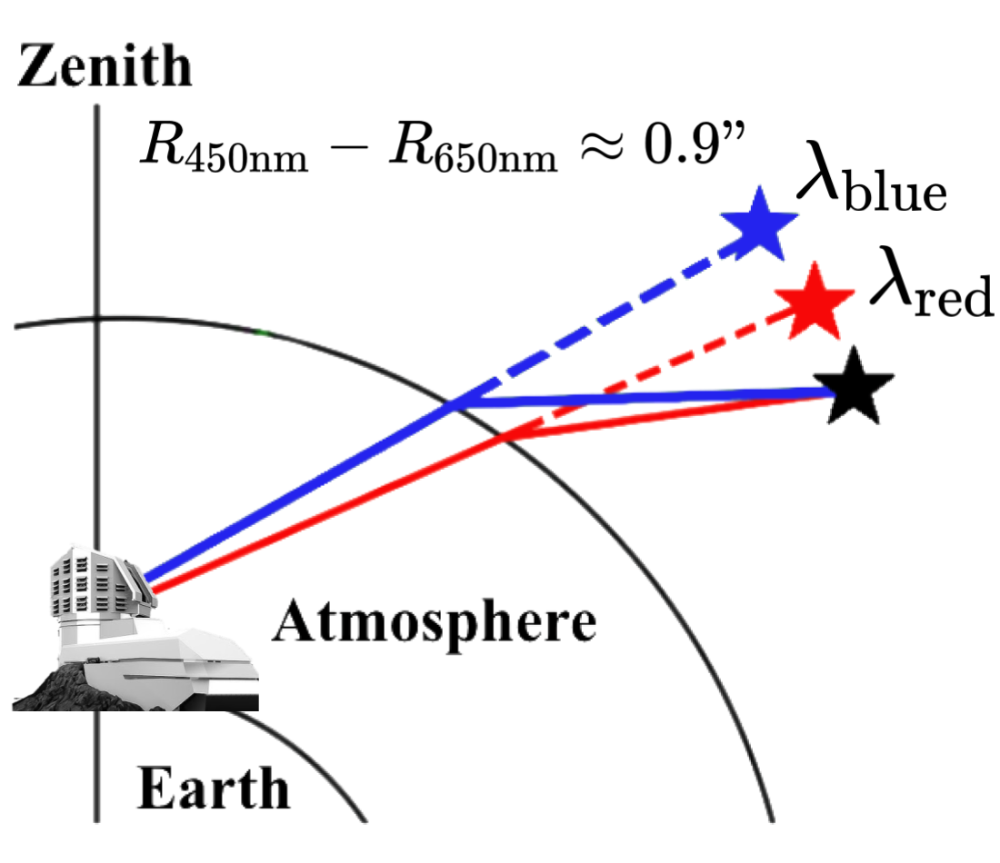
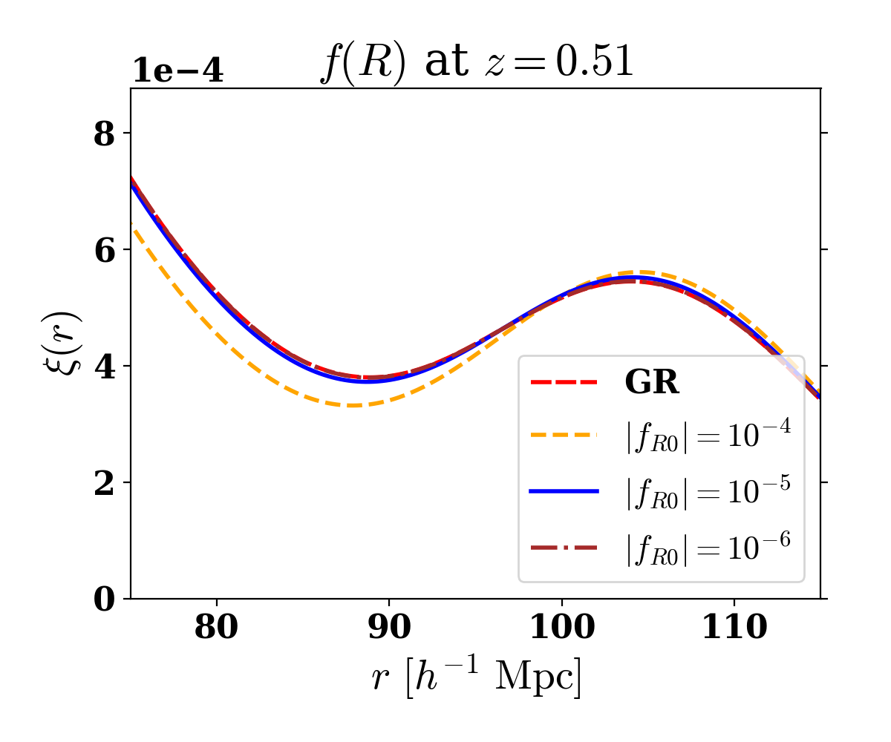

## Type Ia supernova cosmology

{: .align-center width="620" }

The amount by which light is refracted in Earth's atmosphere depends on its wavelength because the atmosphere's refractive index is wavelength-dependent. This phenomenon is called **differential chromatic refraction (DCR)**. Although DCR must be corrected to measure supernova fluxes accurately, it can also help us measure supernova redshifts.

A Type Ia supernova occurs when a white dwarf undergoes a thermonuclear explosion. The consistent, standardizable luminosities of these events make them valuable distance indicators. By observing many SNe Ia over a range of redshifts, cosmologists can constrain the expansion history of the universe.

## Baryon acoustic oscillations

{: .align-center width="680" }

Before the universe was about 400,000 years old, photons and baryonic matter formed a tightly coupled plasma. Radiation pressure pushed this material outward from primordial overdensities while gravity pulled matter inward, producing acoustic oscillations. When photons began to propagate freely, the characteristic scale of these oscillations became imprinted in the distribution of matter.

My BAO work has focused on the **linear point**, the midpoint between the peak and dip scales in the two-point correlation function. The linear point is more stable against nonlinear evolution than either feature individually. We found that it remains robust in modified-gravity models and can be measured more precisely than the peak or dip alone.

## Cosmic infrared background

{: .align-center width="900" }

The cosmic infrared background (CIB) is primarily emission from dust in star-forming galaxies. Young stars emit ultraviolet and visible light that is absorbed by surrounding dust and re-emitted at far-infrared and submillimeter wavelengths.

With the Websky simulations group in Toronto, I investigated the non-Gaussianity of the CIB and its weak gravitational lensing. By dividing the CIB into redshift shells and lensing each shell with the corresponding convergence field, we found that lensing changes the CIB power spectrum only slightly—about 1–2%—but can alter its non-Gaussian statistics by 10–20% or more.
